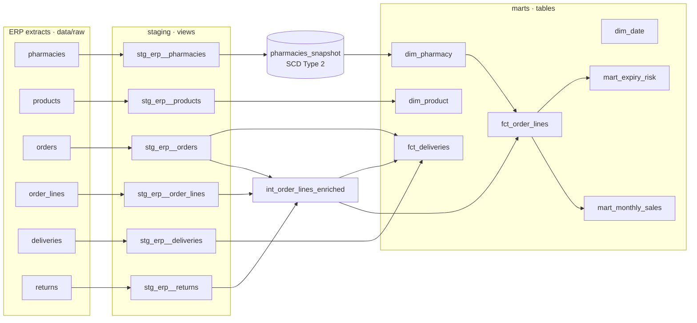

# Pharma Distribution Analytics · dbt + DuckDB

An analytics engineering project for a **fictional Istanbul pharmaceutical wholesaler** delivering to 180 pharmacies from two warehouses. Raw ERP extracts are transformed with **dbt** into a tested star schema with an **SCD Type 2** pharmacy dimension, delivery performance (OTIF) and expiry-loss marts.

**[Browse the live dbt docs and lineage graph →](https://lidianarhoro88.github.io/pharma-distribution-dbt/)**

`dbt build` runs **54 nodes** (models, snapshot and 39 data tests) in about 2 seconds on DuckDB, and the whole project runs on a laptop with no database server.

## Business questions

1. How much do we sell, by month and therapeutic (ATC) group, after returns?
2. Are we delivering **on time and in full (OTIF)**, and which warehouse is behind?
3. Which products lose the most value to **expired returns**?
4. When a pharmacy changes segment, credit limit or district, can history still be reported correctly?

## Lineage



## What the data had to overcome

The generator (`scripts/generate_data.py`) deliberately produces the problems a real ERP export has:

| Problem in the extract | Where it is fixed | Result |
|---|---|---|
| District written **19 ways** (`KADIKOY`, `kadikoy`, `Kadikoy `) | `normalize_district` macro in staging | 8 canonical Istanbul districts, enforced by `accepted_values` |
| Pharmacy codes in mixed case (`ph-0012` vs `PH-0012`) | `upper(trim())` in staging | joins from orders resolve 100 % (`relationships` test) |
| **44 duplicated order lines** | `row_number()` dedup in `stg_erp__order_lines` | `unique` on `line_id` |
| Empty `delivered_at` for in-transit orders | `nullif` + cast in staging | delivered vs in-transit flag |
| Master data changing between extracts | dbt **snapshot** (check strategy) | 198 versions for 180 pharmacies, 18 closed |

## Results (synthetic data, Jan–Oct 2026)

| Measure | Value |
|---|---|
| Net sales (excluding cancelled orders) | ₺33.8 M over 3,021 orders |
| On-time delivery | **86.7 %** |
| OTIF (on time and no returns) | **77.3 %** |
| On-time by warehouse | IST-ANADOLU 89.9 % · IST-AVRUPA **83.3 %** |
| Return rate (value) | 1.88 % of net sales |
| Value lost to expired stock | ₺290 K across 90 SKUs; the top 10 SKUs account for **44.9 %** |

**Reading it:** the European-side warehouse is the delivery problem, not the carriers or cold-chain items (cold-chain orders are on time at about the same rate). Expiry losses are concentrated, so a FEFO rotation review on ten SKUs would address almost half of the loss.

## Tests

Generic tests (`unique`, `not_null`, `relationships`, `accepted_values`) cover every key and foreign key, plus:

| Test | Guards against |
|---|---|
| `one_current_row_per_pharmacy` (custom generic) | an SCD2 dimension with zero or two current versions |
| `assert_delivered_after_dispatch` | impossible delivery timestamps |
| `assert_returns_not_above_sold` | returns larger than the quantity sold |
| `assert_revenue_reconciles` | the monthly mart drifting from the fact table |

## Run it

```bash
pip install -r requirements.txt
python run_pipeline.py      # day-1 build → day-2 build (SCD2 changes) → static docs
```

Or step by step:

```bash
export DBT_PROFILES_DIR=.
python scripts/generate_data.py --day 1 && dbt build
python scripts/generate_data.py --day 2 && dbt build      # snapshot records the changes
dbt docs generate --static                                # target/static_index.html
```

Query the result:

```bash
duckdb pharma.duckdb "select * from marts.mart_expiry_risk limit 10"
```

The generated dbt documentation (lineage graph, every column and test) is in [`docs/index.html`](docs/index.html).

## Power BI report

The marts feed a three-page Power BI report (Overview, Delivery, Expiry risk), styled with a wine and gold theme.

```bash
python scripts/export_powerbi.py      # marts → powerbi/data/*.csv
```

| File | Purpose |
|---|---|
| `powerbi/data/*.csv` | Pharmacy, Product, Date, Warehouse, OrderLines, Deliveries |
| `powerbi/measures.dax` | 20 DAX measures: net sales, return rate, on-time %, OTIF %, expired value, top-10 SKU share |
| `powerbi/theme_wine_gold.json` | report theme |

Model: `OrderLines` and `Deliveries` are facts; `Date`, `Product`, `Pharmacy` and `Warehouse` filter them (one-to-many, single direction). `Pharmacy` holds the current version of each pharmacy; the SCD2 history stays in `marts.dim_pharmacy`.

Reconciliation targets (the report must show the same numbers as the dbt marts): net sales ₺33.83 M, return rate 1.88 %, on-time 86.7 %, OTIF 77.3 %, expired value ₺289.7 K, top-10 SKU share 44.9 %.

## Modelling decisions

- **Grain first.** `fct_order_lines` is one row per ERP order line; `fct_deliveries` is one row per dispatched order. Measures that live at different grains are kept in different facts instead of being repeated on every line.
- **Cancelled orders are kept and flagged**, not deleted, so revenue excludes them while cancellation rates stay measurable.
- **SCD Type 2 with a surrogate key.** `pharmacy_key` identifies a version; `pharmacy_code` identifies the pharmacy. Facts join to the current version here; joining on `order_date between valid_from and valid_to` gives point-in-time reporting.
- **Staging is views, marts are tables.** Cheap to rebuild, fast to query.
- **DuckDB reads the CSVs directly** through `external_location` sources, so there is no separate load step.

## Project structure

```
scripts/generate_data.py      synthetic ERP extracts (day 1 / day 2)
models/staging/               one model per source table: rename, cast, trim, dedupe
models/intermediate/          line-level enrichment with returns
models/marts/                 dimensions, facts, monthly sales, expiry risk
snapshots/                    SCD Type 2 pharmacy snapshot
macros/                       district normalisation, schema naming
tests/                        singular and custom generic tests
run_pipeline.py               end-to-end demo
.github/workflows/dbt.yml     CI: generate → build → test on every push
```

All pharmacies, products and transactions are synthetic. The scenario reflects how pharmaceutical distribution data behaves; it does not describe any real company.
